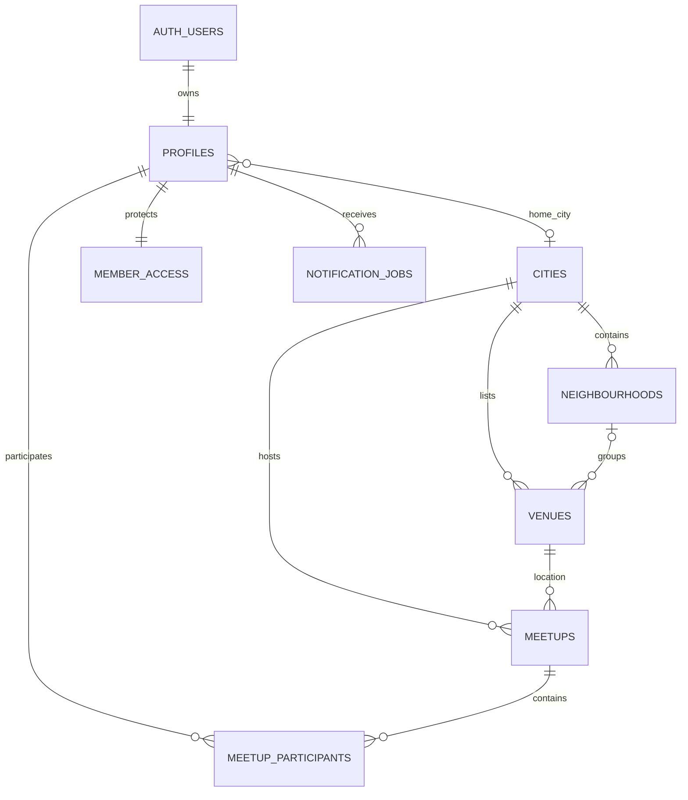

# Database architecture

## City expansion is data, not a new deployment

Accounts and private verification state are global. A profile's optional home city is a preference, not an authorization boundary. A member can browse another active city's venues without creating another account. Completed-meetup usage remains global across travel and city changes.

- UUID primary keys are independent of names, countries, and city slugs.
- City slugs are unique within an ISO-style country code, allowing equally named cities in different countries.
- Each city has a validated IANA timezone. Event times use `timestamptz`; display formatting uses the event city's timezone, not a fixed UK offset.
- Composite foreign keys prevent a venue referencing a neighbourhood in another city and a meetup referencing a venue in another city.
- City/status/time indexes support local feeds; user/status indexes support account history.
- The venue directory currently bounds each city query to 50 rows. Add keyset pagination before expanding a city beyond this display limit.
- Countries/regions are descriptive attributes, not separate shards. Avoid per-city tables, projects, and schemas.
- Profile rows contain no raw location tracking. Venue coordinates are nullable until checked. Before implementing proximity discovery, add PostGIS geography/GiST indexes and server-side distance queries; this slice performs city filtering only.

## Access boundaries

All exposed application tables have RLS enabled and explicit grants. Unconfirmed or suspended members fail the shared authoritative email/account check. Profiles and preferences are readable only by their owner. Profile writes go through narrowly scoped RPCs. Other members cannot retrieve a private photo object.

Sensitive counters, account status, upload quotas, and delivery jobs live in the unexposed `private` schema. Anonymous and authenticated roles have no direct write access. Never put staff roles or ID approval in editable Auth user metadata.

Public RPC functions default to no PUBLIC/anonymous execution. Only the handful needed by a confirmed member are granted; upload finalization, job claiming, maintenance, and quotas are service-only. Keep the server secret key out of the browser.

## Three-meetup allowance foundation

`private.member_access` is a row-locked global allowance aggregate, backed by `meetup_participants` records. Every participant insert reserves allowance atomically. The partial unique index additionally permits only one unfinished confirmed reservation per member.

The participant transition trigger releases reservations on cancellation/no-show and increments completion exactly once on a valid reserved-to-completed transition. Only a trusted completed meetup whose end time has passed can enter that transition. After three completed or reserved meetups, further reservations require approved ID status.

The client cannot insert participants, mark a meetup complete, change counters, or approve ID. Service API participant deletion is also denied; cancellation is a transition, preserving the audit history. Future acceptance should insert both participants inside one database transaction, locking member rows in stable UUID order. Future completion must validate both acknowledgments or an authorized staff resolution before updating the trusted meetup lifecycle.

These are database foundations, not a shipped matching API. ID evidence/reviewer tables and user-facing upload/review must be added in the later verification milestone.

## Files and delivery

Photo bytes live in private Supabase Storage; profile rows store versioned object paths. The upload action decodes/re-encodes supported images, strips metadata, and permits at most 3 attempts per minute / 20 per UTC day per member. Storage upload policies do not permit browser mutation. Finalization and the welcome job are committed together. If finalization fails, the handler deletes the newly uploaded object. Daily cleanup removes unreferenced objects older than one day.

Jobs use `FOR UPDATE SKIP LOCKED`, expiring leases, unique event keys, retry limits, and provider idempotency keys. A stale worker cannot finish a newer worker's lease. Compact sent/skipped rows retain event keys so replaying an onboarding action does not send another welcome.

## Add the next city

1. Insert a city with its country code, slug, centre coordinates, timezone, and `planned` status.
2. Insert neighbourhoods, then venues referencing that city's UUID.
3. Record venue source URLs/check dates. Use `listed` for researched catalogue entries and `approved` only after the actual review process.
4. Activate the city when its catalogue is ready. It appears in city selectors without a code release.
5. Populate checked venue coordinates before exposing map pins. Do not substitute a city centre for every restaurant's location.

Manchester is the only initially seeded active city. See [the source register](manchester-venues.md).

## Growth and operations

Start with one Supabase Free Postgres database. Keep queries city-scoped and bounded, monitor query plans and slow queries, and add indexes for measured workloads. Do not partition or shard before traffic warrants it. Row counts, photo egress, and notification backlog are the first usage metrics to watch.

Keep migrations in Git. Move operational city additions into migrations or a controlled admin workflow. Export database data and Storage objects separately; database exports do not contain the pictures. Test restore before live launch. Free-tier quota/availability constraints still apply; this design supports multiple cities but does not claim unlimited capacity on a free plan.
